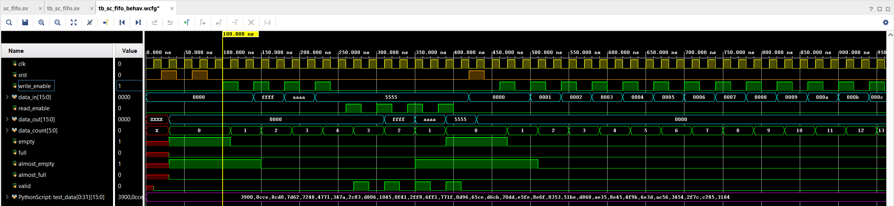
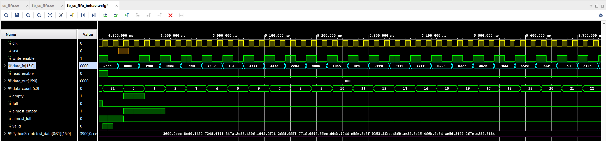
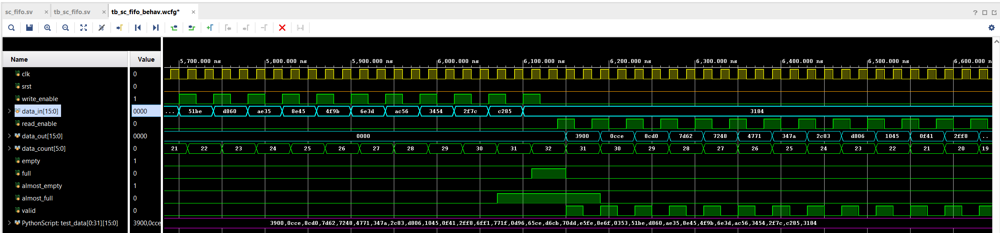
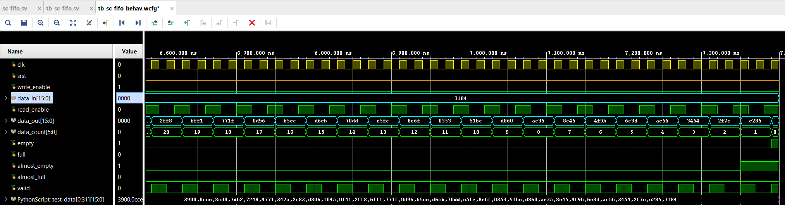
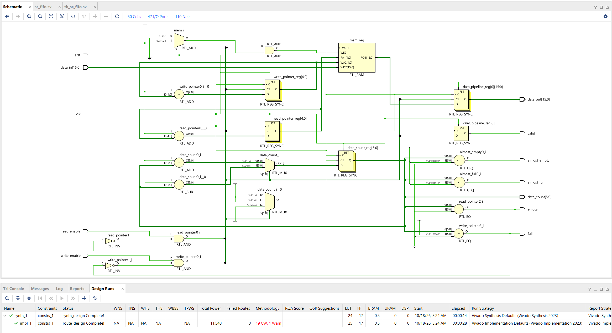

# BRAM FIFO

## Overview
This design implements a First-In-First-Out (FIFO) memory container using SystemVerilog HDL and Block RAM (BRAM) in Vivado. The FIFO writes incoming data into memory and reads it in the same order it was written.

## Software
- Vivado 2023.1
- SystemVerilog HDL
- Python 3

## Functionality
The parameters for this FIFO are as follows:

- `WIDTH = 16`: Bit width per stored word.
- `DEPTH = 32`: Maximum number of memory locations.
- `ALMOST_EMPTY_THRESHOLD = 1`: Threshold indicating when the FIFO is almost empty.
- `ALMOST_FULL_THRESHOLD = 31`: Threshold indicating when the FIFO is almost full.
- `READ_LATENCY = 1`: Number of registered output pipeline stages.

The FIFO uses the FPGA's internal memory, known as Block RAM (BRAM), to store incoming data. A write pointer determines the memory address where incoming data is stored, while a read pointer determines the memory address from which data is retrieved. A data counter tracks the number of words stored in the FIFO. Based on this counter, status flags indicate whether the FIFO is almost empty, empty, almost full, or full. The write pointer, read pointer, and data counter update on the rising edge of the clock.

Additionally, a Python script generates 32 data values. These are 16-bit values stored in hexadecimal format. The testbench loads the values using the `$readmemh` function to verify that all values can be written into and read from the FIFO in the correct order.

## Testbench
The functionality was verified using a testbench with the following ten test cases:

1\. Reset: Clears the FIFO count and output registers.  
2\. Data Patterns: Writes and reads `0000`, `FFFF`, `AAAA`, and `5555` to verify correct data storage and FIFO ordering.  
3\. Fill All Memory Locations: Writes 32 values to fill the FIFO and checks the full and almost-full flags.  
4\. Overflow: Attempts to write `DEAD` while the FIFO is full and verifies that the write is rejected.  
5\. Full FIFO Readback: Reads all stored values and verifies their order.  
6\. Underflow: Attempts to read an empty FIFO and verifies that the request is rejected.  
7\. Simultaneous Read/Write: Verifies simultaneous read and write operations when the FIFO contains data.  
8\. Simultaneous Read/Write While Empty: Verifies simultaneous read and write operations when the FIFO is empty.  
9\. Simultaneous Read/Write While Full: Verifies simultaneous read and write operations when the FIFO is full.  
10\. Python-Generated Data: Verifies that the 32 Python-generated 16-bit values are written and read back in the correct order.  

### Behavioral Simulation Waveforms
Below is the behavioral simulation waveform with the testbench values:

  
  

Below is the behavioral simulation waveform with the Python-generated Script values:

  
  
  

## Block Diagram

