# BRAM FIFO

## Software Tools & Languages Used
- Vivado 2023.1
  - SystemVerilog Hardware Description Language (HDL)
- Python 3 IDE
  - Python Programming Language

## Overview
This design implements a First-In-First-Out (FIFO) memory container using SystemVerilog HDL and Block RAM (BRAM) in Vivado. The FIFO writes incoming data into memory and reads it in the same order it was written. Additionally, the program was created using a Tool Command Language (TCL) script which auto populated the project files with its design source and simulation source files.

## Functionality
The parameters for this FIFO are as follows:

`WIDTH = 16`: Bit width per stored word.
`DEPTH = 32`: Maximum number of memory locations.
`ALMOST_EMPTY_THRESHOLD = 1`: Threshold indicating when the FIFO is almost empty.
`ALMOST_FULL_THRESHOLD = 31`: Threshold indicating when the FIFO is almost full.
`READ_LATENCY = 1`: Number of registered output pipeline stages.

The FIFO uses the FPGA's internal memory, known as Block RAM (BRAM), to store incoming data. A write pointer determines the memory address where incoming data is stored, while a read pointer determines the memory address from which data is retrieved. A data counter tracks the number of words stored in the FIFO. Based on this counter, status flags indicate whether the FIFO is almost empty, empty, almost full, or full. The write pointer, read pointer, and data counter update on the rising edge of the clock.

Additionally, another Python TCL script generates 32 data values. These are 16-bit values stored in hexadecimal format. The testbench loads the values using the `$readmemh` function to verify that all values can be written into and read from the FIFO in the correct order.

## Testbench
The functionality was verified using a testbench with the following ten test cases:

1\. `Reset`: Clears the FIFO count and output registers.  
2\. `Data Patterns`: Writes and reads `0000`, `FFFF`, `AAAA`, and `5555` to verify correct data storage and FIFO ordering.  
3\. `Fill All Memory Locations`: Writes 32 values to fill the FIFO and checks the full and almost-full flags.  
4\. `Overflow`: Attempts to write `DEAD` while the FIFO is full and verifies that the write is rejected.  
5\. `Full FIFO Readback`: Reads all stored values and verifies their order.  
6\. `Underflow`: Attempts to read an empty FIFO and verifies that the request is rejected.  
7\. `Simultaneous Read/Write`: Verifies simultaneous read and write operations when the FIFO contains data.  
8\. `Simultaneous Read/Write While Empty`: Verifies simultaneous read and write operations when the FIFO is empty.  
9\. `Simultaneous Read/Write While Full`: Verifies simultaneous read and write operations when the FIFO is full.  
10\. `Python-Generated Data`: Verifies that the 32 Python-generated 16-bit values are written and read back in the correct order.  

### Behavioral Simulation Waveforms
Below is the full behavioral simulation waveform, then the same waveform broken into ten images:

  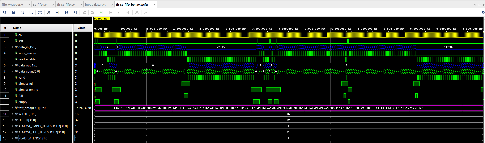

 

  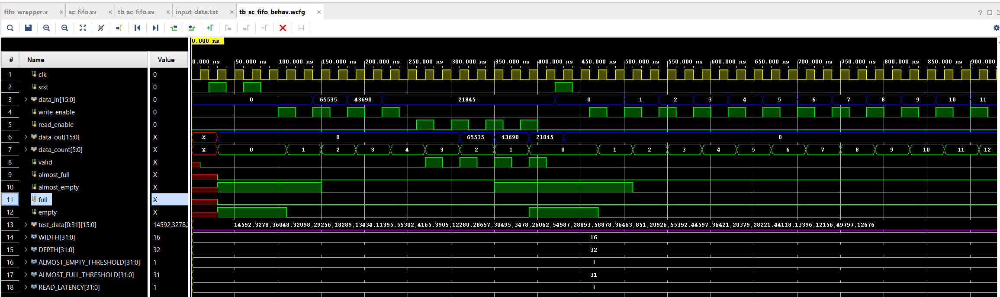
  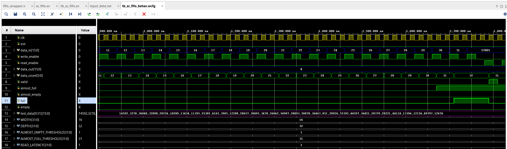

 

  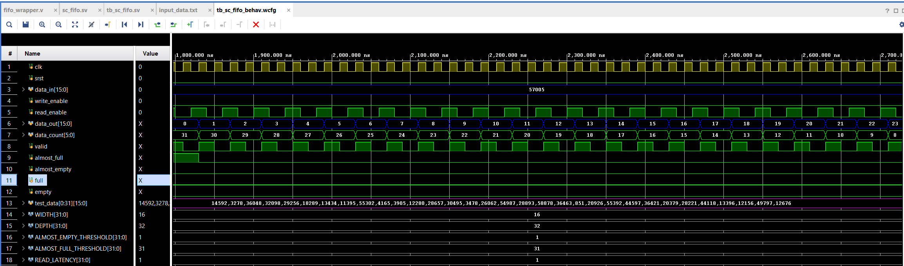
  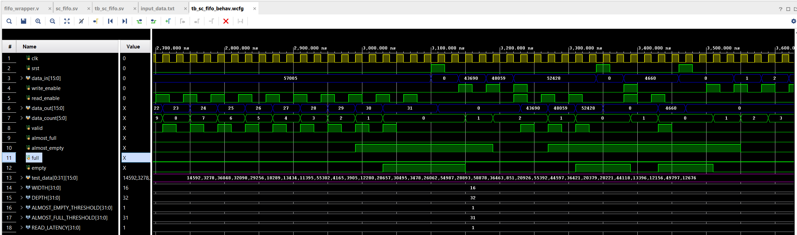

 

  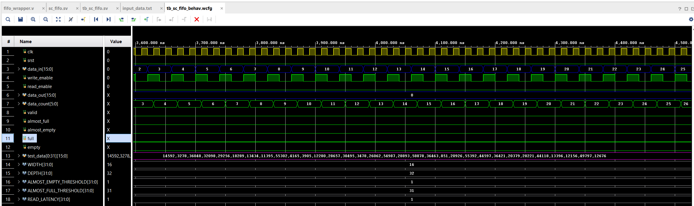
  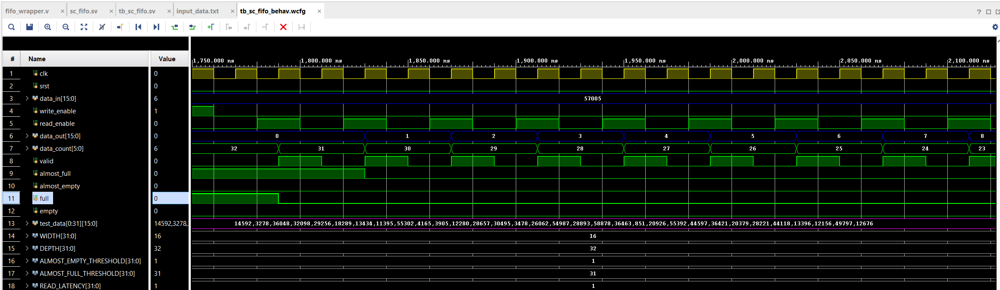

 

  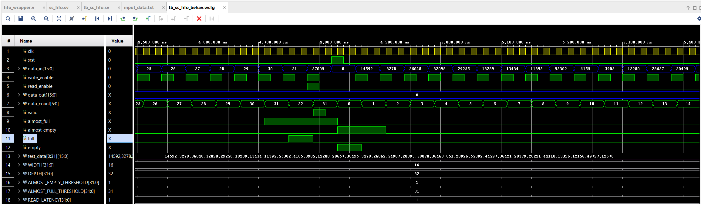
  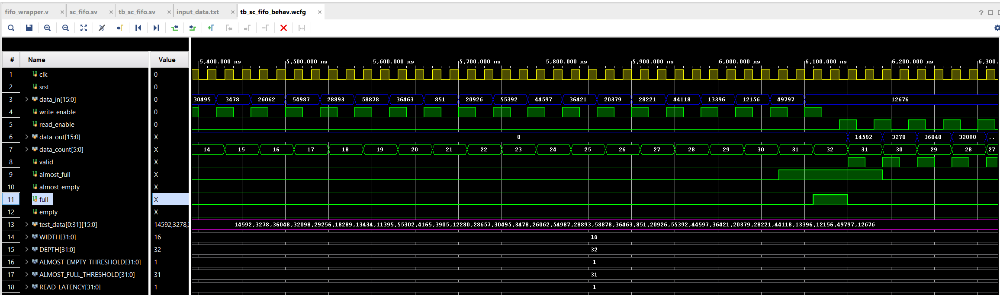

 

  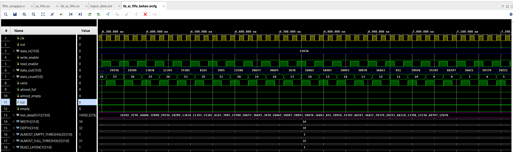
  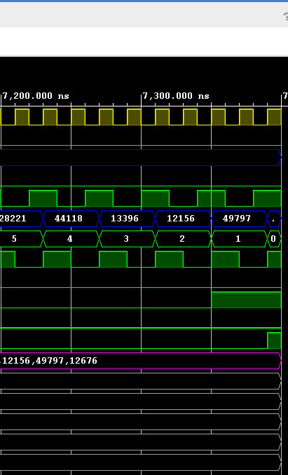

  
The simulation shows all test cases functioning properly:  
1.\ `Reset`:	At 0–40ns,`srt` is asserted and signals `data_count`, `valid`, and `data_out` are zero while the `empty` status flag is 1.  
2. `Data Patterns`: At 40–420ns, data values `0000`, `FFFF`, `AAAA`, and `5555` are written into the FIFO, then are read to the output in that same order. As the data values are written, the `data_count` signal increments and decrements to indicate the amount of data values stored in the FIFO.  
3. `Fill All Memory Locations`: At 420–1,760ns, the FIFO writes `0000` through `001F`. Then, `data_count` reaches 32. Before filling up, the `almost_full` signal is asserted at 31, then the `full` signal is asserted after once the FIFO is full.  
4. `Overflow`: At	1,760–1,800ns, the FIFO attempts to write DEAD while the FIFO is full, and the `data_count` signal remains 32. `DEAD` occurs when there is an overflow as coded in the simulation source code.  
5. `Full FIFO Readback`: From 1,800–3,080ns, all data values are read starting from `0000` to `001F`. Then, the `data_count` signal decreases from 32 to 0. The `almost_empty` and `empty` signals are asserted as the FIFO reaches close to empty, then empty.  
6. `Underflow`: At 3,080–3,120ns, when the FIFO attempts to read a value while empty, the `data_count` signal remains 0 and the `valid` signal stays LOW.  
7. `Simultaneous read/write`: At	3,120–3,350ns, the FIFO writes `AAAA` and `BBBB`, then reads and writes simultaneously with `CCCC`. The count remains 2 during the simultaneous operation indicating that there are two stored values in the FIFO still.  
8. `Simultaneous read/write while empty`:	At 3,350–3,490ns, both enables assert while empty. The write is then accepted, but the read is rejected. Then, the `data_count` signal becomes 1.  
9. `Simultaneous read/write while full`: At	3,490–4,830ns, the FIFO fills to 32, then performs a simultaneous read/write. The `data_count` then decreases to 31.
10. `Python-generated data`: From	4,830 to 7,350ns, the FIFO writes the 32 generated values from the memory file, fills the FIFO, then reads them back in order. The `data_count` signal then returns to 0.  

## Block Diagram
Below is the RTL schematic of the BRAM FIFO which was coded versus generated through the IP Catalog:

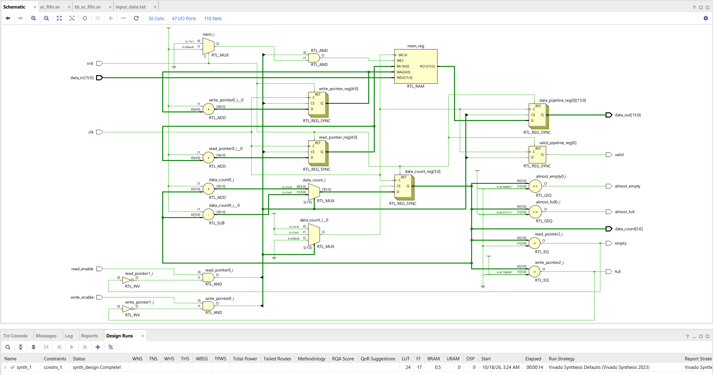

Below is the IP Block Diagram of the BRAM FIFO:

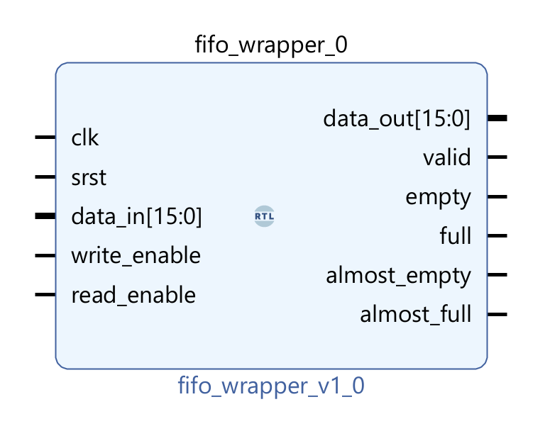

- To create this IP Generated Block Diagram, Vivado needed a `.v` file versus a `.sv` file. So, `fifo_wrapper.v` was created as a top module to instantiate `sc_fifo.sv` inside. Then, when selecting to create a block diagram, I added `fifo_wrapper.v` to infer the IP Generated Block Diagram.

### Synthesis Utilization Summary
Below shows the amount of resources used to implement this BRAM FIFO design:

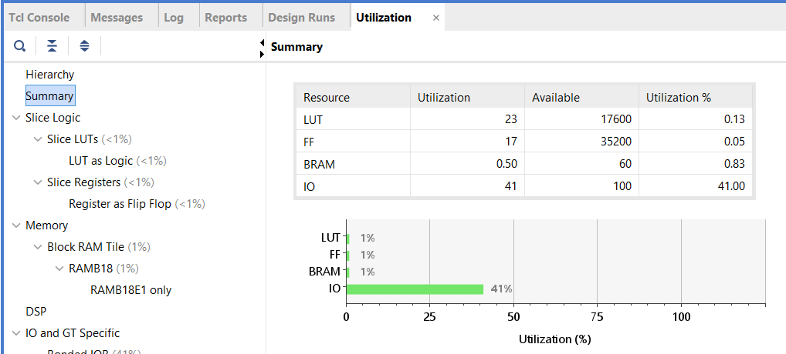
